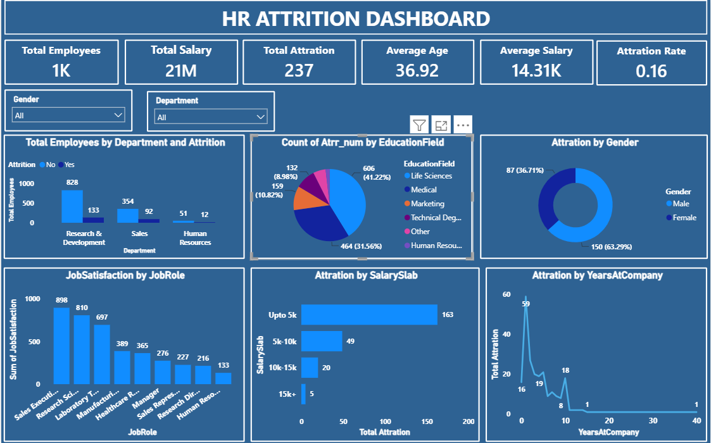

# 👥 HR Attrition Analysis Dashboard

### 📊 Employee Attrition Analysis using Microsoft Power BI

---

## 📌 Project Overview

This project focuses on analyzing employee attrition using Microsoft Power BI. The dashboard helps understand employee turnover patterns and explore how attrition varies across different employee demographics and job-related factors.

The goal is to transform HR data into meaningful insights through interactive visualizations and key performance indicators (KPIs).

---

## 🎯 Project Objectives

- Analyze employee attrition trends.
- Track important HR performance indicators.
- Understand attrition patterns across departments and job roles.
- Explore employee demographics and salary-related patterns.
- Present HR insights through an interactive dashboard.

---

## 🛠️ Tech Stack

| Technology | Purpose |
|---|---|
| Microsoft Power BI | Dashboard development and visualization |
| Power Query | Data transformation and preparation |
| DAX | KPI calculations and measures |
| CSV Dataset | Employee data source |

---

## 🔄 Project Workflow

1. Import the HR dataset into Power BI.
2. Review and prepare the data.
3. Create measures and calculate KPIs using DAX.
4. Build charts and visualizations.
5. Design an interactive HR dashboard.
6. Analyze employee attrition patterns and summarize findings.

---

## 📈 Dashboard KPIs

The dashboard focuses on the following HR metrics:

- Total Employees
- Attrition Count
- Attrition Rate
- Average Employee Age
- Average Salary

---

## 📊 Analysis Performed

- Employee attrition by department
- Attrition by gender
- Attrition by age group
- Attrition by job role
- Salary-related analysis

---

## 🖼️ Dashboard Preview
## Dashboard Preview

The Power BI dashboard provides a visual overview of employee attrition and key HR metrics.

Add your dashboard screenshot here after uploading it to this repository.

Example:

``

Make sure the image filename matches the actual uploaded screenshot.

---

## 💡 Key Learnings

- Working with HR data in Power BI
- Creating KPI cards and DAX measures
- Designing interactive reports
- Using charts to explore employee attrition patterns
- Presenting data-driven HR insights

---

## 📁 Repository Structure

HR-Attrition-Analysis-PowerBI/

├── README.md

├── HR-Attrition-Analysis.pbix

└── HR-Attrition-Dashboard.png

---

## 🚀 Skills Demonstrated

- Data Analysis
- Data Visualization
- Power BI Dashboard Development
- Power Query
- DAX Measures
- KPI Reporting
- Business Intelligence

---

## 👩‍💻 Author

**Bharti Pal**

Aspiring Data Analyst | MIS Executive

Skills: Excel • SQL • Python • Power BI

---

This project demonstrates the use of Power BI to explore HR data and communicate employee attrition patterns through data visualization.
